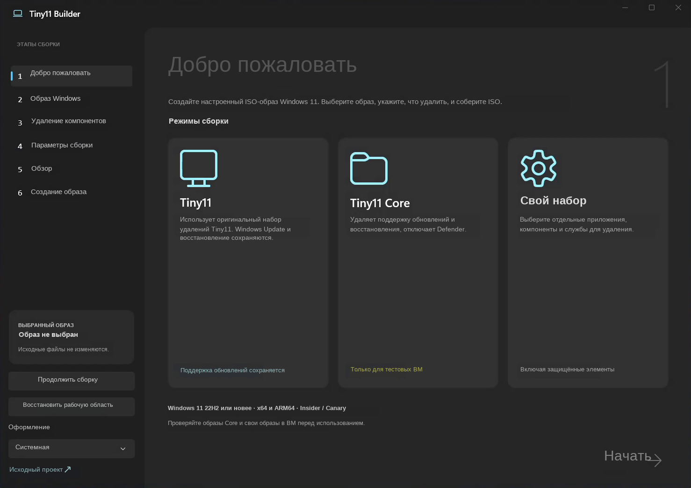
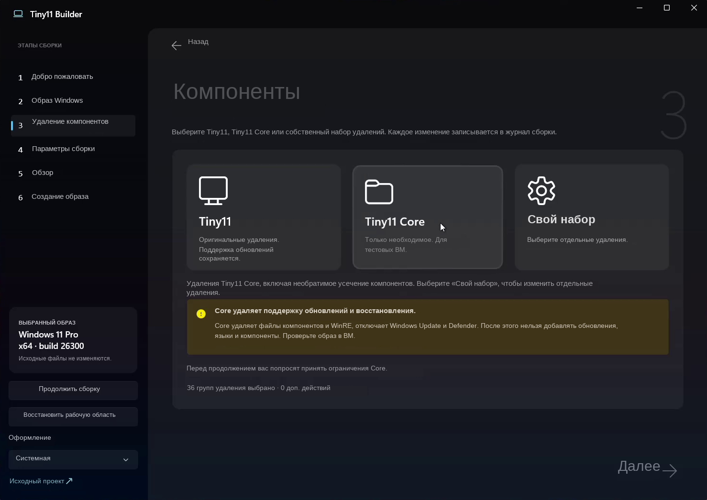
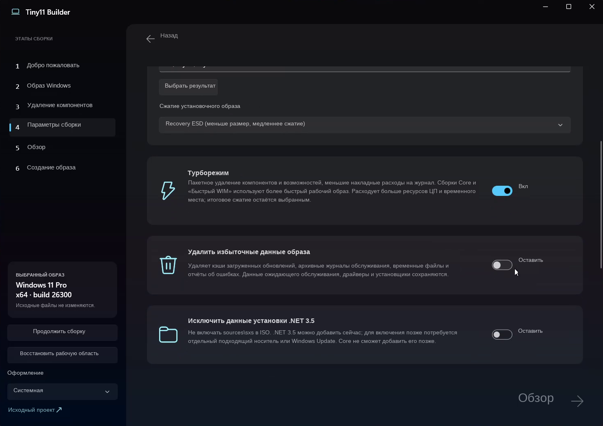

# Tiny11 Builder WinUI 0.1.2 — полностью русский исходный код

Полная русификация [Tiny11 Builder WinUI 0.1.2](https://github.com/ntdevlabs/tiny11builder/releases/tag/winui-v0.1.2) —
оригинальной английской программы от [ntdevlabs/tiny11builder](https://github.com/ntdevlabs/tiny11builder)
(tag `winui-v0.1.2`, commit `eb4c794`).

## Что это такое

Tiny11 Builder — это программа/утилита, которая позволяет «облегчить» Windows 11: из официального
ISO-образа вырезаются ненужные компоненты (Teams, Copilot, телеметрия и т. п.), чтобы система
занимала меньше места и работала на слабом железе. В результате получается свой собственный ISO,
который можно записать на флешку и установить. Исходный образ при этом не изменяется.

Полный исходный код Tiny11 Builder WinUI 0.1.2 с полностью русским интерфейсом: окна, диалоги,
статусы, журнал и тесты. Логика программы не изменена; строки, которые читают внешние системы
Windows (DISM, реестр), оставлены английскими намеренно.

Перевод и проверки сделаны с помощью ИИ (Qwen) и проверены дифференциальными тестами.
**Готовый архив x64 — в [Release «Tiny11 Builder 0.1.2_Rus»](../../releases).**

## Скриншоты

**Добро пожаловать** — режимы сборки Tiny11 / Tiny11 Core / свой набор:



**Удаление компонентов** — выбор набора и предупреждения Core:



**Параметры сборки** — сжатие образа, турборежим, исключение .NET 3.5:



Снимки окон оригинальной английской версии 0.1.2 с русскими надписями из словаря поставки:
в исходниках этого репозитория переведены ≈1000 строк кода и 147 строк разметки, поэтому
собранная отсюда (или из готового архива) программа показывает те же окна на русском.

Оригинальный английский README апстрима сохранён как `README.upstream.md`,
атрибуция — в `NOTICE.md` и разделе «Правовая заметка» ниже.

## Состав

| Путь | Что это |
|---|---|
| `src/` | приложение WinUI (`Tiny11Builder.App`) и движок (`Tiny11Builder.Core`) — **строки переведены**: C#-литералы (≈1000) и XAML-атрибуты (147) |
| `tests/` | юнит-тесты движка и логики приложения — переведены синхронно с кодом (падают/проходят так же, как английские) |
| `overlay/` | `Tiny11Builder.Ru` — рантайм-слой из готовых архивов: перевод XAML-текстов из `MainWindow.xbf` (147 пар), журнал `ru-localization.log`, иконка-триколор, страховка от кодировочного мусора вывода DISM |
| `icon/` | иконка-триколор (ICO, 16–256 px), вшитая в EXE готовых архивов |
| `docs/` | `REPORT_RU.md` — полный технический отчёт (аудит, метод, верификация, ревизии); `README_RU.txt` — памятка из готовых архивов; `usage.ru.md` — краткое руководство пользователя |
| `tiny11maker.ps1`, `tiny11Coremaker.ps1`, `autounattend.xml`, `scripts/` | файлы оригинального проекта апстрима (без изменений по назначению) |

## Как получить русскую программу

1. **Готовый архив (рекомендуется):** скачайте `Tiny11Builder-0.1.2-ru-win-x64.zip`
   из [Release](../../releases) — это официальный релиз апстрима с заменёнными
   `Tiny11Builder.dll`, `Tiny11Builder.Core.dll`, `deps.json`, вшитой иконкой и добавленными
   `Tiny11Builder.Ru.dll` + `README_RU.txt`. Распакуйте и запустите `Tiny11Builder.exe`.
2. **Собрать из этого репозитория (нужна Windows 10/11 + VS 2022 / .NET SDK 8 с WinUI):**
   ```
   dotnet publish src/Tiny11Builder.App/Tiny11Builder.App.csproj -c Release -p:Platform=x64 -p:RuntimeIdentifierOverride=win-x64
   ```
   XAML-тексты уже русские в разметке; оверлей `Tiny11Builder.Ru` в этом сценарии не обязателен
   (он нужен для варианта 1), но его подключение добавляет журнал, иконку и страховку кодировок.

## Тесты

```
dotnet test tests/Tiny11Builder.Core.Tests
```
На Windows проходят так же, как английские оригиналы; на Linux часть тестов падает
из-за Windows-API (одинаково в английской и русской версиях — проверено дифференциально,
см. `docs/REPORT_RU.md`, раздел 3).

## История ревизий готовых архивов

| Ревизия | Содержание |
|---|---|
| rev.1–rev.2 | первая русификация (база 0.1.1); rev.2 устранил зависание старта |
| rev.3–rev.3.2 | список компонентов, OEM-кодировка DISM, иконка в EXE, исправления эмиссии IL, самовосстановление кодировочного мусора (база 0.1.1) |
| **rev.4 (текущий Release)** | база — официальный релиз **0.1.2**: исправление кодировок DISM от апстрима + наша страховка, словарь 1076 записей, оверлей rev.3.3 |

## Правовая заметка

Апстрим не содержит лицензионного файла; его `NOTICE.md` прямо требует подтвердить права до
перераспределения. Материалы локализации этого репозитория (оверлей, документация, переводы
строк) распространяются по MIT (см. `LICENSE`). Переведённые исходники `src/`, `tests/` и
готовые архивы в Release являются производными от нелицензированного апстрима:
их публикация — решение и ответственность владельца репозитория. Торговые марки Windows/Microsoft
и изображение государственного флага РФ использованы в описательно-оформительских целях.
